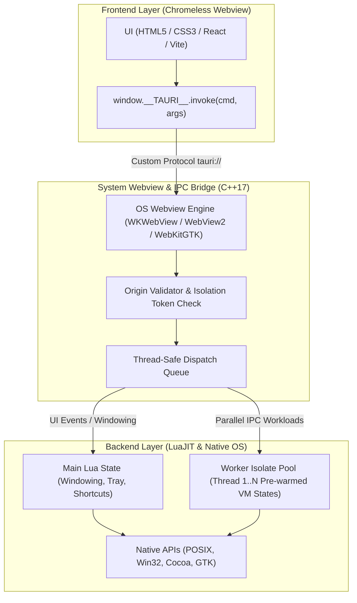

# Tauri-Lua ⚡️

> **Ultra-lightweight, memory-efficient desktop runtime combining the modern architecture of Tauri with the raw execution speed and developer ergonomics of LuaJIT.**

[](#cross-platform-implementation-details)
[](#benchmarks--performance-profile)
[](#architecture-overview)
[](#license)

> [!NOTE]
> **Educational & Research Exploration**  
> This project is an independent engineering proof-of-concept demonstrating how Tauri's architecture, security sandbox, and developer experience can be implemented using a minimal C++17 native bridge and LuaJIT. It is not affiliated with or endorsed by The Tauri Programme.

---

## Executive Summary

**Tauri-Lua** bridges modern web frontends (Vite, React, Vue, Svelte, or Vanilla JS) with an ultra-fast, native backend written in Lua, running on **LuaJIT** and backed by a lightweight C++17 system bridge.

It faithfully replicates the **Tauri specification, directory layout, and Developer Experience (DX)**—including capabilities-based security, IPC envelopes, and native packaging—while bypassing the heavy Rust compilation pipeline.

### Why does this exist?

Building small-to-medium desktop applications with Electron produces 150+ MB installers and consumes 200+ MB of RAM at idle. Tauri with Rust is vastly superior in resource usage, but Cargo build times (often 2–5 minutes) and gigabyte-sized toolchains introduce significant friction for developers seeking instant feedback loops.

**Tauri-Lua delivers the best of both worlds:**
* **Instant Builds:** Native runtime compiles in **~3 seconds**.
* **Zero-Recompile Backend Reloading:** Backend Lua changes reload in **~50 milliseconds**.
* **Microscopic Footprint:** Production executable binary is **~175 KB**, with bundle disk images under **100 KB**.
* **Enterprise Cybersecurity:** Hardened process spawning (zero command injection), dual-layer Content Security Policy (CSP), Origin Isolation, and Capability/Scope gating modeled after Tauri v2.
* **Instant App Scaffolding:** Interactive `lua-tauri create` command supporting Vanilla, React, Vue, Svelte, and Tailwind CSS with pre-wired Vite templates.
* **Custom Native Menu Bar (Tauri 2 / `muda` Parity):** Fluent OOP & declarative menus (`Menu`, `Submenu`, `MenuItem`, `CheckMenuItem`, `PredefinedMenuItem`) with OS responder chain integration and dual Lua/JS event routing.
* **Non-Blocking Multi-Core Concurrency:** Built-in Worker Isolate Pool distributes CPU-heavy workloads across hardware threads without stalling the 60/120 FPS UI loop.

---

## Benchmarks & Performance Profile

| Metric | Tauri-Lua | Tauri v2 (Rust) | Electron v30 |
| :--- | :---: | :---: | :---: |
| **Clean Build Time** | **~3 seconds** | 2 – 5 minutes | 1 – 3 minutes |
| **Backend Hot-Reload** | **~50 ms** *(script swap)* | 10 – 30 seconds *(cargo rebuild)* | 1 – 3 seconds *(process restart)* |
| **Binary Size (Executable)** | **~175 KB** | ~8 – 15 MB | ~130 – 180 MB |
| **RAM at Idle** | **~35 MB** *(system webview)* | ~35 MB *(system webview)* | ~150 – 250 MB *(bundled chromium)* |
| **Toolchain Dependencies** | **`luajit` + `cmake`** | `rustc` + `cargo` + platform SDKs | `node` + `npm` + Python + build-tools |
| **Scripting Engine** | **LuaJIT 2.1** *(Near C performance)* | Native Machine Code | V8 JavaScript Engine |

---

## Architecture Overview



### Core Runtime vs. Application Space (Separation of Concerns)

Tauri-Lua maintains a strict, decoupled boundary between the **Core Framework Engine** and **User Application Space**:

| Layer | Files / Location | Responsibilities & Lifecycle |
| :--- | :--- | :--- |
| **Core Runtime Engine** | `src/` (C++17) & `src/tauri/init.lua` | **Permanent System Layer.** Contains the OS window host (Cocoa/GTK/Win32), isolation token generator, origin validator, thread-safe Isolate Worker Pool, IPC router, `window.__TAURI__.Channel` streaming pipeline, file-system drivers, and native dialog wrappers. This layer is compiled into the binary and is permanently active. |
| **User Application Space** | `src-tauri/src/main.lua` & `tauri.conf.json` | **Developer Logic.** Where you define application state (`app.state`), register business logic endpoints (`app:register(...)`), and configure capabilities. If you remove or refactor any user command (e.g. removing a streaming demo handler), the underlying engine capabilities remain completely intact and ready for future handlers with zero overhead. |

---

## When to Use Tauri-Lua

### Ideal Use Cases
1. **Developer Tools & Utilities:** Diagnostics, system monitors, log viewers, device managers, and CLI companion GUIs.
2. **Internal Enterprise Tools:** Operations dashboards, hardware interfaces, and rapid proof-of-concept enterprise applications.
3. **High-Performance Micro-Apps:** Native desktop clients that need to start in under 200ms and run persistently in the system tray with negligible RAM usage.
4. **Embedded & Resource-Constrained Environments:** Embedded Linux devices (Raspberry Pi, industrial tablets) where LLVM/Rust toolchains are too resource-heavy to maintain on-device.

### When to Stick with Tauri (Rust) or Electron
* **Complex Multi-Threaded Memory Ownership:** If you require compile-time memory safety proofs and strictly typed shared-memory structures across dozens of concurrent native threads.
* **Mobile Targets:** If your primary roadmap necessitates iOS and Android binaries (Tauri-Lua deliberately focuses on Desktop: macOS, Linux, Windows).
* **Deep Chromium Hooks:** If you require low-level internal Chromium DevTools Protocol (CDP) manipulation unavailable in OS-native webviews.

---

## Project Structure (1:1 with Tauri Spec)

Tauri-Lua adopts the official Tauri layout. The application backend and configurations are strictly separated from frontend assets:

```text
my-app/
├── package.json              # Optional: Frontend dependencies & npm scripts
├── dist/                     # Frontend production build output
│   ├── index.html
│   ├── assets/
│   └── ...
├── src-tauri/                # Native application root
│   ├── tauri.conf.json       # Central declarative configuration
│   ├── icons/                # Multi-resolution icons (.icns, .ico, pngs)
│   └── src/
│       └── main.lua          # Backend entrypoint (equivalent to main.rs)
├── target/                   # Distribution artifacts
│   └── bundle/
│       ├── macos/            # Standalone .app bundle
│       ├── dmg/              # Mountable .dmg installer
│       └── deb/              # Debian / Ubuntu package
├── lua-tauri                 # Unified CLI executable
└── src/                      # Tauri-Lua C++ Core Engine (Shared Runtime)
```

---

## Getting Started

### Prerequisites

* **macOS:** `clang` (Xcode Command Line Tools), `cmake`, `luajit` (`brew install luajit cmake`).
* **Linux (Debian/Ubuntu):** `build-essential`, `cmake`, `luajit`, `libgtk-3-dev`, `libwebkit2gtk-4.0-dev`.
* **Windows:** Visual Studio C++ Build Tools, `cmake`, `luajit`, Microsoft Edge WebView2 (pre-installed on Win 10/11).

### Quickstart

Scaffold a new project in seconds or run the development environment:

```bash
# 1. Create a project interactively (Vanilla, React, Vue, Svelte, Tailwind)
./lua-tauri create my-app

# 2. Enter project and start development mode (Hot Reload enabled)
cd my-app
../lua-tauri dev

# 3. Package for production (.dmg / .app on macOS, .deb on Linux)
../lua-tauri build
```

---

## The CLI: Developer Workflow

The included `./lua-tauri` CLI provides full workflow parity with `@tauri-apps/cli`:

### `lua-tauri create [app-name]`
Interactive and automated project scaffolder. Generates a modern Vite frontend pre-wired to `src-tauri/` with zero configuration needed.

```bash
# Interactive mode (asks for Framework, Tailwind CSS, Package Manager):
./lua-tauri create my-desktop-app

# Automated non-interactive mode:
./lua-tauri create my-react-app --template react --tailwind --pm pnpm
./lua-tauri create my-vue-app --template vue --no-tailwind --pm npm
./lua-tauri create my-svelte-app --template svelte --pm bun
./lua-tauri create my-vanilla-app --template vanilla
```

**Supported Options:**
* `--template, -t <vanilla | react | vue | svelte>` — Frontend framework.
* `--tailwind / --no-tailwind` — Pre-configure Tailwind CSS v3 with PostCSS and autoprefixer.
* `--pm, --package-manager <npm | pnpm | bun | yarn>` — Package manager of choice.

### `lua-tauri dev`
Starts the development cycle:
1. Executes `build.beforeDevCommand` (e.g. `npm run dev`) if specified.
2. Polls `build.devUrl` until your frontend dev server (e.g., Vite) is ready.
3. Launches the native desktop runtime pointed to your dev server.
4. Activates the **Backend File Watcher**: any modification in `src-tauri/src/*.lua` or `tauri.conf.json` automatically triggers a hot restart in **~50ms**.
5. Automatically terminates the development session when the application window is closed by the user.

```bash
./lua-tauri dev
```

### `lua-tauri build`
Generates optimized production distributions:
1. Executes `build.beforeBuildCommand` (e.g. `npm run build`) to produce `frontendDist`.
2. Compiles user scripts and core libraries into bytecode using `luajit -b`.
3. Inlines the bytecode and configuration directly into the compiled native binary.
4. Generates standard platform bundles:
   - **macOS:** `.app` and `.dmg` inside `target/bundle/`
   - **Linux:** `.deb` inside `target/bundle/deb/`
   - **Windows:** Standalone folder with `.exe` in `target/bundle/windows/`

```bash
./lua-tauri build
```

### `lua-tauri init`
Scaffolds a `src-tauri/` directory structure with a baseline `tauri.conf.json` and boilerplate `main.lua` into any existing web project.

```bash
./lua-tauri init
```

### `lua-tauri icon <source.png>`
Generates all multi-resolution platform icon sets (`.icns`, `.ico`, 32x32, 128x128) from a single 1024x1024 source image.

```bash
./lua-tauri icon app-icon.png
```

---

## Declarative Configuration: `tauri.conf.json`

The runtime configuration adheres to the modern **Tauri v2 schema**:

```json
{
  "$schema": "https://schema.tauri.app/v2",
  "productName": "tauri-lua-app",
  "version": "1.0.0",
  "identifier": "com.tauri.lua",
  "build": {
    "beforeDevCommand": "npm run dev",
    "devUrl": "http://localhost:5173",
    "beforeBuildCommand": "npm run build",
    "frontendDist": "../dist"
  },
  "app": {
    "windows": [
      {
        "title": "Tauri Lua Production App",
        "width": 1024,
        "height": 720,
        "resizable": true
      }
    ],
    "security": {
      "capabilities": [
        "core:default",
        "fs:read-text-file",
        "fs:write-text-file",
        "dialog:open",
        "dialog:save",
        "clipboard:write-text"
      ],
      "scope": [
        "$APPDATA/*",
        "$DESKTOP/*",
        "$HOME/Documents/*"
      ]
    }
  }
}
```

---

## Backend Programming Model (`main.lua`)

Writing native commands in Lua is simple, expressive, and thread-safe:

```lua
-- src-tauri/src/main.lua
local Tauri = require("tauri")

-- 1. Initialize application with configuration
local conf = {}
if __EMBEDDED_CONFIG_JSON__ then
    conf = Tauri.json.decode(__EMBEDDED_CONFIG_JSON__) or {}
end
local app = Tauri.init(conf)

-- 2. Persistent Thread-Safe Application State
if not app.state:has("counter") then
    app.state:set("counter", 0)
end

-- 3. Register IPC Command (callable from JavaScript via invoke())
app:register("calculate_fibonacci", function(payload)
    local n = tonumber(payload.n) or 20
    local a, b = 0, 1
    for _ = 1, n do
        a, b = b, a + b
    end

    -- Update state across workers
    local count = app.state:get("counter") + 1
    app.state:set("counter", count)

    return {
        input = n,
        result = a,
        totalInvocations = count,
        workerId = __ISOLATE_WORKER_ID__ or 0
    }
end)

-- 4. Create native window
app:create_main_window()
```

### Frontend Invocation (JavaScript / TypeScript)

Invoke registered commands from any frontend framework using the standard Tauri IPC interface:

```javascript
import { invoke } from '@tauri-apps/api/core'; // Or window.__TAURI__.invoke

async function calculate() {
  try {
    const response = await window.__TAURI__.invoke('calculate_fibonacci', { n: 40 });
    console.log('Result from Lua backend:', response.result);
    console.log('Processed by worker:', response.workerId);
  } catch (error) {
    console.error('IPC Error:', error);
  }
}
```

### Real-Time Streaming Channels (`Tauri v2 Parity`)

Stream live progress, shell logs, or continuous data chunks from Lua to JavaScript without global event bus pollution:

**In Lua Backend (`src-tauri/src/main.lua`):**
```lua
app:register("stream_countdown", function(payload, caller, channel)
    local ch = channel or (payload and payload.onProgress)
    for i = 5, 1, -1 do
        ch:send({ tick = i, message = "Processing step #" .. i })
        Tauri.sleep(200) -- Built-in cross-platform millisecond sleep
    end
    return { status = "completed" }
end)
```

**In JavaScript Frontend:**
```javascript
const channel = new window.__TAURI__.Channel((data) => {
  console.log("Received stream chunk:", data.message);
});

const result = await window.__TAURI__.invoke("stream_countdown", {
  onProgress: channel
});
console.log("Stream finished:", result.status);
```

---

## Built-In Desktop APIs

Tauri-Lua provides a comprehensive set of built-in system abstractions accessible from both Lua and JavaScript:

### 1. File System (`fs`)
Guarded by security capabilities (`fs:read-text-file`, `fs:write-text-file`) and sandbox scopes:
* `tauri:fs:read` — Reads UTF-8 file contents.
* `tauri:fs:write` — Atomically writes text to file.
* `tauri:fs:list` — Non-blocking directory traversal.
* `tauri:fs:remove` — File removal within allowed scope.

### 2. Native Dialogs (`dialog`)
System-native modals matching host OS design tokens:
* `tauri:dialog:open` — Native file/folder selection picker.
* `tauri:dialog:save` — Save file destination picker.
* `tauri:dialog:message` — Native informational message box.
* `tauri:dialog:ask` — Native confirmation dialog (Yes / No).

### 3. System Tray (`tray`)
* `tauri:tray:create` — Instantiates a status bar / tray icon with custom tooltip.
* Tray item click dispatches natively to `__TAURI_DISPATCH_TRAY__(id)`.

### 4. Global Shortcuts & Deep Links
* `tauri:shortcut:register` — Binds system-wide hotkeys (e.g. `CmdOrCtrl+Shift+K`).
* `tauri:deep-link` — Handles custom protocol callbacks (`my-app://action?token=...`).

### 5. Multi-Window Management & Window Lifecycle Events
* **Programmatic Creation:** `app:register("open_window", ...)` -> `tauri:window:create`.
* **Controls:** `minimize`, `maximize`, `unmaximize`, `show`, `hide`, `close`, `destroy`, and custom borderless window drag (`start_dragging`).
* **Off-Screen Geometry Setup:** Windows are sized, styled, and centered off-screen before presentation, eliminating visual resize jumps, flicker, and bounce glitches.

#### Window Lifecycle & Unsaved Data Protection (`prevent_default`)
Essential for production applications (document editors, dashboards, forms) where closing a window inadvertently would result in data loss. Tauri-Lua intercepts the native OS close signal **before** window destruction occurs:
* **macOS:** Cocoa delegate `[windowShouldClose:]` intercepts close and returns `NO` when cancelled.
* **Windows:** Win32 message loop intercepts `WM_CLOSE` and aborts `DestroyWindow`.
* **Linux:** GTK3 connects to `"delete-event"` and returns `TRUE` to halt window destruction.

##### 1. Backend Interception (`Lua`)
```lua
app:on_window_event(function(event)
    if event.event == "close-requested" then
        print("[LIFECYCLE] Window close requested for:", event.label)

        -- 1. Check if there are unsaved changes
        local has_unsaved_data = check_unsaved_changes()

        if has_unsaved_data then
            -- 2. Intercept and block OS destruction
            event:prevent_default()
            print("[LIFECYCLE] Window close cancelled; protecting user data.")

            -- 3. Trigger frontend prompt or native confirmation dialog
            app:emit("prompt-unsaved-changes", { label = event.label })
        end
    end
end)

-- When the user confirms "Discard & Exit", force window destruction:
app:register("confirm_discard_and_close", function(payload)
    app:destroy_window(payload.label) -- Unconditional native close
end)
```

##### 2. Frontend Interception (`JavaScript`)
```javascript
import { getCurrentWebviewWindow } from "@tauri-apps/api/webviewWindow";

const appWindow = getCurrentWebviewWindow();

// Listen for native close requests (clicking X or pressing Cmd+W / Alt+F4)
await appWindow.onCloseRequested(async (event) => {
  if (isEditorDirty) {
    // Prevent the window from closing immediately
    event.preventDefault();

    const saveChanges = await window.__TAURI__.dialog.ask(
      "You have unsaved changes. Do you want to save before closing?",
      { title: "Unsaved Changes", type: "warning" }
    );

    if (saveChanges) {
      await saveDocument();
      await appWindow.destroy(); // Force close after saving
    } else {
      const forceDiscard = await window.__TAURI__.dialog.ask("Discard all changes and exit?");
      if (forceDiscard) {
        await appWindow.destroy(); // Force close without saving
      }
    }
  }
});
```


### 6. Hardened Process Execution (`shell`)
Direct kernel-level process spawning with zero shell interpolation and real-time streaming:
* `tauri:shell:execute` — Spawns processes directly via `posix_spawnp` (macOS/Linux) or `CreateProcessA` (Windows) using discrete `argv` arrays.

**Frontend Usage (`JavaScript`):**
```javascript
// 1. Discrete argument array (Recommended: immune to command injection)
await window.__TAURI__.shell.execute("ping", ["-c", "3", "127.0.0.1"], (chunk) => {
  console.log("Live stdout:", chunk.line);
});

// 2. Safe string parsing (Tokenizes arguments without invoking /bin/sh)
const result = await window.__TAURI__.shell.execute("git status -s");
console.log("Exit code:", result.code);
console.log("Output:\n", result.stdout);
```

### 7. Custom Native Menu Bar API (Tauri 2 / `muda` Parity)

Tauri-Lua delivers 100% ergonomic parity with the **Tauri 2 (`muda`) Menu Specification** directly in Lua and C++17, compiling into native OS menu bar items (**Cocoa `NSMenu`** on macOS, **Win32 `HMENU`** on Windows, and **GTK3 `GtkMenuBar`** on Linux) without external dependencies or Electron bloat.

#### Architecture Highlights
* **Native OS Responder Chain:** Standard items (`undo`, `copy`, `paste`, `quit`, `minimize`, etc.) are wired directly to native OS handlers (Cocoa selectors on macOS, `WM_COMMAND` / `WM_CLOSE` on Windows, and GTK window actions on Linux) requiring zero manual JS/Lua code to handle clipboard and window shortcuts.
* **Dual-Channel Event Dispatching:** Custom items dispatch simultaneously to the Lua backend (`app:on_menu(cb)`) and the frontend webview (`window.__TAURI__.menu.onMenuClicked(cb)` and `tauri://menu-event`).
* **OOP Builders & Declarative Tables:** Supports both fluent OOP builder classes (`Tauri.Menu`, `Tauri.Submenu`, etc.) and plain declarative Lua tables.

#### Component Classes Reference

| Class | Constructor | Description |
| :--- | :--- | :--- |
| `Tauri.Menu` | `Menu.new(options)` | Root menu bar container. Also supports `Menu.default()` to generate standard OS menus. |
| `Tauri.Submenu` | `Submenu.new(options)` | Nested dropdown menu (e.g. *File*, *Edit*, *Window*). |
| `Tauri.MenuItem` | `MenuItem.new(options)` | Standard clickable menu item with unique `id`, `text`, and optional `accelerator`. |
| `Tauri.CheckMenuItem` | `CheckMenuItem.new(options)` | Toggleable menu item with checkmark state (`checked = true/false`). |
| `Tauri.PredefinedMenuItem` | `PredefinedMenuItem.<role>()` | Built-in system items mapped to native operating system roles. |

#### Predefined OS Roles (`PredefinedMenuItem`)

| Helper Method | Role Identifier | Default Accelerator | Native OS Action (macOS / Windows / Linux) |
| :--- | :--- | :--- | :--- |
| `PredefinedMenuItem.separator()` | `separator` | — | `NSMenuItem separatorItem` / `MF_SEPARATOR` / `GtkSeparatorMenuItem` |
| `PredefinedMenuItem.undo([text])` | `undo` | `CmdOrCtrl+Z` | `undo:` / `WM_UNDO` / Undo action |
| `PredefinedMenuItem.redo([text])` | `redo` | `CmdOrCtrl+Shift+Z` | `redo:` / Redo action |
| `PredefinedMenuItem.cut([text])` | `cut` | `CmdOrCtrl+X` | `cut:` / `WM_CUT` / Cut action |
| `PredefinedMenuItem.copy([text])` | `copy` | `CmdOrCtrl+C` | `copy:` / `WM_COPY` / Copy action |
| `PredefinedMenuItem.paste([text])` | `paste` | `CmdOrCtrl+V` | `paste:` / `WM_PASTE` / Paste action |
| `PredefinedMenuItem.select_all([text])` | `select_all` | `CmdOrCtrl+A` | `selectAll:` / Select all action |
| `PredefinedMenuItem.minimize([text])` | `minimize` | `CmdOrCtrl+M` | `performMiniaturize:` / `SW_MINIMIZE` / `gtk_window_iconify` |
| `PredefinedMenuItem.zoom([text])` | `zoom` | — | `performZoom:` / `SW_MAXIMIZE` / `gtk_window_maximize` |
| `PredefinedMenuItem.fullscreen([text])` | `fullscreen` | `Ctrl+Cmd+F` | `toggleFullScreen:` / Fullscreen Toggle / `gtk_window_fullscreen` |
| `PredefinedMenuItem.hide([text])` | `hide` | `CmdOrCtrl+H` | `hide:` / `ShowWindow(SW_HIDE)` / Minimize to tray |
| `PredefinedMenuItem.hide_others([text])` | `hide_others` | `Alt+Cmd+H` | `hideOtherApplications:` / OS application hide |
| `PredefinedMenuItem.show_all([text])` | `show_all` | — | `unhideAllApplications:` / Unhide all |
| `PredefinedMenuItem.close_window([text])`| `close_window`| `CmdOrCtrl+W` | `performClose:` / `WM_CLOSE` / `gtk_window_close` |
| `PredefinedMenuItem.quit([text])` | `quit` | `CmdOrCtrl+Q` | `terminate:` / `PostQuitMessage` / `gtk_main_quit` |
| `PredefinedMenuItem.about([text])` | `about` | — | `orderFrontStandardAboutPanel:` / About dialog |

#### Full Implementation Example

##### 1. Backend (`Lua`)
```lua
local Tauri = require("tauri")
local app = Tauri.init(conf)

local Menu = Tauri.Menu
local Submenu = Tauri.Submenu
local MenuItem = Tauri.MenuItem
local CheckMenuItem = Tauri.CheckMenuItem
local PredefinedMenuItem = Tauri.PredefinedMenuItem

-- Compose application menu bar
local menu = Menu.new({
    items = {
        Submenu.new({
            text = "File",
            items = {
                MenuItem.new({ id = "new_project", text = "New Project", accelerator = "CmdOrCtrl+N" }),
                MenuItem.new({ id = "open_file", text = "Open...", accelerator = "CmdOrCtrl+O" }),
                PredefinedMenuItem.separator(),
                PredefinedMenuItem.close_window(),
            }
        }),
        Submenu.new({
            text = "Edit",
            items = {
                PredefinedMenuItem.undo(),
                PredefinedMenuItem.redo(),
                PredefinedMenuItem.separator(),
                PredefinedMenuItem.cut(),
                PredefinedMenuItem.copy(),
                PredefinedMenuItem.paste(),
                PredefinedMenuItem.select_all(),
            }
        }),
        Submenu.new({
            text = "View",
            items = {
                CheckMenuItem.new({ id = "toggle_fps", text = "Show Performance Metrics", checked = true }),
                PredefinedMenuItem.separator(),
                PredefinedMenuItem.fullscreen(),
            }
        }),
        Submenu.new({
            text = "Window",
            items = {
                PredefinedMenuItem.minimize(),
                PredefinedMenuItem.zoom(),
                PredefinedMenuItem.separator(),
                PredefinedMenuItem.close_window(),
            }
        }),
        Submenu.new({
            text = "Help",
            items = {
                MenuItem.new({ id = "docs", text = "Documentation" }),
                PredefinedMenuItem.about(),
            }
        })
    }
})

-- Assign menu to the application
app:set_menu(menu) -- Or use: app:set_menu(Menu.default())

-- Handle custom menu click events in Lua
app:on_menu(function(event)
    print("[LUA MENU EVENT] Clicked item:", event.id)
    if event.id == "new_project" then
        -- Trigger backend logic, open dialogs, etc.
    end
end)
```

##### 2. Frontend (`JavaScript`)
```javascript
// Method A: Dedicated menu callback
window.__TAURI__.menu.onMenuClicked((event) => {
  console.log("Native menu clicked:", event.id);
});

// Method B: Standard Tauri event bus
window.__TAURI__.event.listen("tauri://menu-event", (event) => {
  console.log("Menu event received:", event.payload.id);
});

// Method C: Dynamically update or set menu from frontend
await window.__TAURI__.menu.setMenu({
  items: [
    {
      text: "Tools",
      items: [
        { id: "export_pdf", text: "Export to PDF...", accelerator: "CmdOrCtrl+E" }
      ]
    }
  ]
});
```

### 8. Single-Instance Application Lock (`single-instance` Parity)

Tauri-Lua guarantees that only a single instance of your application runs at any time, preventing duplicate windows, split-brain state, or file database corruption:

* **POSIX (macOS & Linux):** Manages a dedicated Unix domain socket (`/tmp/<app_id>.sock` or `$XDG_RUNTIME_DIR/<app_id>.sock`) with automatic stale socket cleanup.
* **Windows (Win32):** Operates a system-wide Named Pipe (`\\.\pipe\<app_id>-single-instance`).
* **Instant Handshake & Forwarding:** When a user opens a second instance (e.g. clicking the app icon again or double-clicking an associated file):
  1. The second instance forwards its CLI `argv` arguments and `cwd` to the running primary instance.
  2. The primary instance automatically unminimizes and brings its main window to the front (`platform_window_set_focus`).
  3. The primary instance emits `tauri://single-instance` to the frontend and triggers backend Lua handlers.
  4. The second instance exits cleanly with exit code `0` before initializing any webview or isolate overhead.

#### Configuration (`tauri.conf.json`)
```json
{
  "plugins": {
    "single-instance": {
      "enabled": true
    }
  }
}
```

#### 1. Backend Usage (`Lua`)
```lua
local app = Tauri.init(conf)

-- Listen for second instance launch events and received arguments
app:on_single_instance(function(data)
    print("[SINGLE-INSTANCE] Second instance attempted launch with arguments:")
    for i, arg in ipairs(data.args) do
        print(string.format("  arg[%d] = %s", i, arg))
    end
    print("[SINGLE-INSTANCE] Working directory:", data.cwd)

    -- Focus window and notify the user
    app:set_window_focus("main")
    app:notify("App Already Running", "Switched focus to existing window.")
end)
```

#### 2. Frontend Usage (`JavaScript`)
```javascript
// Method A: Dedicated Single-Instance plugin hook
window.__TAURI__.singleInstance.onSecondInstance((data) => {
  console.log("Second instance launched with CLI args:", data.args);
  console.log("Originating working directory:", data.cwd);
  
  if (data.args.includes("--open-file")) {
    const fileIndex = data.args.indexOf("--open-file") + 1;
    openDocument(data.args[fileIndex]);
  }
});

// Method B: Standard Tauri event listener
window.__TAURI__.event.listen("tauri://single-instance", (event) => {
  console.log("Single-instance event:", event.payload);
});
```

---

### 9. Native Desktop Notifications (`notification` Parity)

Tauri-Lua delivers non-blocking, operating-system-native desktop notifications with zero external subshell injection:

* **macOS:** Cocoa `NSUserNotification` via `NSUserNotificationCenter` with a custom delegate (`userNotificationCenter:shouldPresentNotification:` returning `YES`), displaying notification banners with default system sound even when the application is active in the foreground.
* **Windows:** Asynchronous Windows 10/11 Toast Notifications via WinRT `ToastNotificationManager` dispatched with `SW_HIDE` (avoiding intrusive modal message boxes).
* **Linux:** Non-blocking `posix_spawnp` of `notify-send` with discrete `argv` arrays (zero shell interpolation).

#### 1. Backend Usage (`Lua`)
```lua
-- Simple shorthand
app:notify("Download Completed", "All assets have been synchronized.")

-- Or with configuration table
app:notify({
    title = "Compilation Finished",
    body = "Binary compiled successfully in 1.4s."
})

-- Global helper
Tauri.notification.send("System Update", "New version ready to install.")
```

#### 2. Frontend Usage (`JavaScript`)
```javascript
// Check and request permission (matches @tauri-apps/plugin-notification)
const isGranted = await window.__TAURI__.notification.isPermissionGranted();
if (!isGranted) {
  const permission = await window.__TAURI__.notification.requestPermission();
  console.log("Notification permission:", permission);
}

// Send native notification
await window.__TAURI__.notification.sendNotification({
  title: "Cloud Backup",
  body: "Project was successfully backed up to cloud storage."
});
```

---

### 10. Real-Time OS System Theme Detection (`theme` Parity)

Tauri-Lua continuously tracks the host operating system's appearance mode and informs both backend and frontend immediately when the user toggles dark or light mode in system settings:

* **macOS:** Evaluates `[NSApp effectiveAppearance]` / `AppleInterfaceStyle` and observes `AppleInterfaceThemeChangedNotification` via `NSDistributedNotificationCenter`.
* **Windows:** Queries `AppsUseLightTheme` in `HKCU\Software\Microsoft\Windows\CurrentVersion\Themes\Personalize` and listens to `WM_SETTINGCHANGE`.
* **Linux:** Queries `gtk-theme-name` / `gtk-application-prefer-dark-theme` and listens to `notify::gtk-theme-name`.

#### 1. Backend Usage (`Lua`)
```lua
-- Query current theme ("dark" or "light")
local current_theme = app:get_theme()
print("[THEME] Current OS appearance:", current_theme)

-- Listen for real-time appearance changes
app:on_theme_changed(function(theme)
    print("[THEME] System theme toggled to:", theme)
end)
```

#### 2. Frontend Usage (`JavaScript`)
```javascript
// Method A: Query theme programmatically
const theme = await window.__TAURI__.window.theme();
console.log("Current theme:", theme); // "dark" | "light"

// Method B: Listen to live OS theme change events
window.__TAURI__.event.listen("tauri://theme-changed", (event) => {
  console.log("New system theme:", event.payload.theme);
  document.documentElement.setAttribute("data-theme", event.payload.theme);
});
```

---

### 11. Native File Drag & Drop (`file-drop` Parity)

Provides native desktop file drag & drop into webview windows, extracting the **real absolute filesystem paths** without browser sandbox restrictions:

* **macOS:** Swizzles `performDragOperation:` on `WKWebView` to capture `NSPasteboardTypeFileURL`, converting window coordinates and suppressing browser page navigation.
* **Windows:** Registers `DragAcceptFiles` and processes `WM_DROPFILES` via `DragQueryFileA`.
* **Linux:** Configures `gtk_drag_dest_set` and listens to `"drag-data-received"`.

#### 1. Backend Usage (`Lua`)
```lua
app:on_file_drop(function(event)
    print(string.format("[FILE DROP] Window '%s' received event: %s", event.label, event.type))
    print(string.format("  Drop coordinates: x=%d, y=%d", event.position.x, event.position.y))
    for i, path in ipairs(event.paths) do
        print(string.format("  File #%d: %s", i, path))
    end
end)
```

#### 2. Frontend Usage (`JavaScript`)
```javascript
// Method A: Dedicated window drag & drop handler
import { getCurrentWebviewWindow } from "@tauri-apps/api/webviewWindow";

const appWindow = getCurrentWebviewWindow();
appWindow.onDragDropEvent((event) => {
  if (event.type === "drop") {
    console.log("User dropped files:", event.paths);
    console.log("Position:", event.position.x, event.position.y);
  }
});

// Method B: Global event bus listener
window.__TAURI__.event.listen("tauri://drag-drop", (event) => {
  console.log("Dropped paths:", event.payload.paths);
});
```

---

### 12. Advanced Native Clipboard (Text, HTML, Images & Clear)

Full parity with `@tauri-apps/plugin-clipboard-manager`, supporting rich HTML and Base64-encoded image bitmaps:

* **Text:** UTF-8 string read and write (`NSPasteboardTypeString`, `CF_TEXT`, `GtkClipboard`).
* **HTML:** Rich formatted markup (`NSPasteboardTypeHTML`, Windows `CF_HTML`, Linux `text/html`).
* **Images:** PNG and TIFF bitmaps converted directly to/from Base64 (`NSPasteboardTypePNG`, Windows `CF_DIB`).
* **Clear:** Clears the system clipboard atomically.

#### 1. Backend Usage (`Lua`)
```lua
-- Plain text
app.clipboard:write_text("Copied from Lua backend")
local text = app.clipboard:read_text()

-- Rich HTML
app.clipboard:write_html("<strong>Rich Text Content</strong>")
local html = app.clipboard:read_html()

-- Image (Base64 PNG)
app.clipboard:write_image("iVBORw0KGgoAAAANSUhEUgAAAAEAAAABCAQAAAC1HAwCAAAAC0lEQVR42mNk+A8AAQUBAScY42YAAAAASUVORK5CYII=")
local base64_png = app.clipboard:read_image()

-- Clear clipboard
app.clipboard:clear()
```

#### 2. Frontend Usage (`JavaScript`)
```javascript
// 1. Text
await window.__TAURI__.clipboard.writeText("Copied from webview!");
const text = await window.__TAURI__.clipboard.readText();

// 2. Rich HTML
await window.__TAURI__.clipboard.writeHtml("<h1>Formatted Header</h1>");
const html = await window.__TAURI__.clipboard.readHtml();

// 3. Image (Base64 data URL or raw Base64 string)
await window.__TAURI__.clipboard.writeImage("data:image/png;base64,iVBORw0KGgo...");
const imageBase64 = await window.__TAURI__.clipboard.readImage();

// 4. Clear
await window.__TAURI__.clipboard.clear();
```

---

## Security Architecture (Tauri v2 Parity)

Following the **Tauri v2 Defense-in-Depth** cybersecurity standard:

1. **Zero Command-Injection Process Spawning:**
   - Raw `/bin/sh` shell invocations (`io.popen`) are completely bypassed in favor of direct OS process creation (`posix_spawnp` on POSIX and `CreateProcessA` on Windows).
   - Shell control metacharacters (`;`, `&&`, `|`, `$()`, backticks) are delivered verbatim as harmless string parameters to the target binary.
   - Synchronous, thread-safe line buffering (`platform_process_read_line`) streams output chunks to `window.__TAURI__.Channel` in real time.
2. **Dual-Layer Content Security Policy (CSP):**
   - Automatically injected as an HTTP response header (`Content-Security-Policy`) on custom scheme requests (`tauri://localhost`, `asset://`) and as a dynamic DOM `<meta http-equiv="Content-Security-Policy">` tag in all served HTML documents.
   - Neutralizes Cross-Site Scripting (XSS) vectors by strictly enforcing allowed script and connect origins.
   - Configurable declaratively in `tauri.conf.json` (`security.csp`) or dynamically via `app:set_csp("...")`.
3. **Session Isolation Tokens:**
   - A cryptographically random 32-character session token is generated at startup and attached to `window.__TAURI_TOKEN__` as a read-only, non-configurable property.
   - Injected or unauthorized scripts cannot forge IPC invocation payloads.
4. **Strict Origin Gating:**
   - Every IPC dispatch verifies the native window's current URL origin. Requests originating from unapproved domains or unauthorized external pages are immediately rejected.
5. **Capability & Program Whitelisting:**
   - APIs (filesystem, dialogs, clipboard, shell) are rejected at the native boundary unless explicitly enabled in `security.capabilities`.
   - The shell engine supports an optional `allowed_programs` list to restrict command execution exclusively to approved executables.
6. **Path Scope Constraint Enforcement:**
   - Filesystem operations resolve path aliases (`$APPDATA`, `$DESKTOP`, `$HOME`) canonically to prevent directory traversal (`../`) attacks.

---

## Cross-Platform Implementation Details

| Layer | macOS | Linux | Windows |
| :--- | :--- | :--- | :--- |
| **Webview Core** | **WKWebView** (WebKit) | **WebKit2GTK** (WebKitGTK-4.0) | **WebView2** (Chromium Edge) |
| **Window Host** | Cocoa (`NSWindow`) | GTK3 (`GtkWindow`) | Win32 API (`HWND`) |
| **IPC Mechanism** | `WKScriptMessageHandler` | WebKit User Content Controller | `ICoreWebView2::WebMessageReceived` |
| **Native Menu Bar** | Cocoa (`NSMenu`, `NSMenuItem`) | GTK3 (`GtkMenuBar`, `GtkMenuItem`) | Win32 API (`HMENU`, `WM_COMMAND`) |
| **Event Loop** | `[NSApp run]` | `gtk_main()` | `GetMessage` / `DispatchMessage` |
| **Bundle Target** | `.app` & `.dmg` (`hdiutil`) | `.deb` (`dpkg-deb`) | Standalone Folder / Archive |

---

## Packaging & Distribution Guide

Distributing desktop applications across heterogeneous operating systems requires packaging native dependencies, dynamic linkers, and asset bundles appropriately.

```text
target/bundle/
├── macos/
│   └── tauri-lua-app.app           # Self-contained macOS Application Bundle
├── dmg/
│   └── tauri-lua-app_1.0.0_x64.dmg # Compressed mountable Apple Disk Image
├── deb/
│   └── tauri-lua-app_1.0.0_amd64.deb # Standard Debian / Ubuntu package
└── windows/
    └── tauri-lua-app-standalone/   # Portable Windows distribution
```

### 1. Linux Distribution (`.deb` & Shared Libraries)

> [!IMPORTANT]
> **Why copying just the bare binary (`build/tauri_app`) to another Linux machine is not enough:**  
> Native GUI applications on Linux dynamically link against system libraries—specifically `glibc`, `libgtk-3`, and `libwebkit2gtk-4.0`. If a target machine has differing shared object versions or lacks development headers, launching the raw binary directly will result in missing library errors (`cannot open shared object file: libwebkit2gtk-4.0.so.37`).

`./lua-tauri build` automatically assembles a standards-compliant **Debian (`.deb`) package** inside `target/bundle/deb/`:
* Places the stripped binary in `/usr/bin/<app-name>`
* Copies the frontend distribution to `/usr/share/<app-name>/`
* Generates a `DEBIAN/control` manifest specifying the target architecture (`amd64`), version, and metadata.

**Installation by End Users:**
```bash
# Clean install with automatic dependency resolution via apt:
sudo apt install ./target/bundle/deb/tauri-lua-app_1.0.0_amd64.deb

# Or via dpkg:
sudo dpkg -i target/bundle/deb/tauri-lua-app_1.0.0_amd64.deb
sudo apt-get install -f # Fixes any missing system dependencies
```

---

### 2. macOS Distribution (`.app` & `.dmg`)

On macOS, running `./lua-tauri build` produces two artifacts:
1. **Application Bundle (`.app`):** Formatted with strict Apple bundle hierarchy:
   * `Contents/MacOS/<app-name>` (Native executable with bytecode inlined)
   * `Contents/Resources/dist/` (Sandboxed webview assets loaded via `[NSBundle resourcePath]`)
   * `Contents/Info.plist` (DPI-awareness, bundle identifiers, and window metadata)
2. **Apple Disk Image (`.dmg`):** A compressed, read-only disk image ready for user distribution generated via `hdiutil`.

#### Production Code Signing & Notarization (Apple Gatekeeper)
To distribute outside the Mac App Store without triggering Gatekeeper warnings:
```bash
# 1. Sign bundle with your Apple Developer ID
codesign --deep --force --options runtime --sign "Developer ID Application: Your Name (TEAMID)" target/bundle/macos/tauri-lua-app.app

# 2. Package into signed DMG
hdiutil create -volname "tauri-lua-app" -srcfolder target/bundle/macos/tauri-lua-app.app -ov -format UDZO target/bundle/dmg/tauri-lua-app.dmg

# 3. Submit for Apple Notarization
xcrun notarytool submit target/bundle/dmg/tauri-lua-app.dmg --keychain-profile "AC_PASSWORD" --wait
xcrun stapler staple target/bundle/dmg/tauri-lua-app.dmg
```

---

### 3. Windows Distribution (Standalone & WebView2)

On Windows, `./lua-tauri build` produces a standalone portable directory in `target/bundle/windows/` containing:
* The native executable (`.exe`) compiled against the Microsoft C++ Runtime.
* Bundled web assets in `/dist`.

**System Requirement:**  
Tauri-Lua on Windows utilizes the official **Microsoft Edge WebView2** runtime. This is pre-installed on Windows 10 (updated versions) and Windows 11. On older systems, users can download the Evergreen Bootstrapper installer provided by Microsoft.

---

### 4. Automated Multi-Platform CI/CD (GitHub Actions)

You don't need three separate physical machines to build for macOS, Linux, and Windows. Commit the following workflow into `.github/workflows/release.yml` to build all platform artifacts simultaneously in the cloud whenever you push a version tag:

```yaml
name: Release Multi-Platform Bundles

on:
  push:
    tags:
      - 'v*'

jobs:
  build:
    name: Build (${{ matrix.platform }})
    runs-on: ${{ matrix.os }}
    strategy:
      fail-fast: false
      matrix:
        include:
          - platform: macos
            os: macos-latest
            artifact: target/bundle/dmg/*.dmg
          - platform: linux
            os: ubuntu-22.04
            artifact: target/bundle/deb/*.deb
          - platform: windows
            os: windows-latest
            artifact: target/bundle/windows/*

    steps:
      - name: Checkout Source
        uses: actions/checkout@v4

      # Install platform dependencies
      - name: Install Linux Dependencies
        if: matrix.platform == 'linux'
        run: |
          sudo apt-get update
          sudo apt-get install -y cmake build-essential luajit libluajit-5.1-dev libgtk-3-dev libwebkit2gtk-4.0-dev

      - name: Install macOS Dependencies
        if: matrix.platform == 'macos'
        run: brew install cmake luajit

      - name: Install Windows Dependencies
        if: matrix.platform == 'windows'
        run: choco install cmake luajit

      # Run frontend & backend build
      - name: Build Application Bundle
        run: |
          chmod +x ./lua-tauri
          ./lua-tauri build

      # Publish binary to GitHub Releases
      - name: Upload Release Asset
        uses: softprops/action-gh-release@v2
        with:
          files: ${{ matrix.artifact }}
        env:
          GITHUB_TOKEN: ${{ secrets.GITHUB_TOKEN }}
```

---

## Systems Engineering Best Practices for Lua Developers

When scaling your desktop application with Tauri-Lua, adhere to these principal design rules:

1. **Leverage the Worker Isolate Pool:** Long-running calculations (compression, crypto, large JSON parsing) should always be delegated to registered commands. They run on the worker thread pool, keeping the main UI thread silky smooth.
2. **Favor LuaJIT FFI over C Lua API:** When calling native platform libraries directly from Lua, use LuaJIT's `ffi` module. FFI calls are JIT-compiled into raw assembly and avoid Lua stack conversion overhead.
3. **Respect Sandbox Scopes:** Never bypass `self.security:assert_scope()` in custom filesystem handlers. Always resolve system roots via `$APPDATA`, `$DESKTOP`, or `$HOME`.
4. **Keep State Operations Serialized:** The built-in `app.state` provides synchronized atomic access across threads. Store metadata, counters, and cache tables inside `app.state` to ensure multi-isolate consistency.

---

## License

MIT License.
